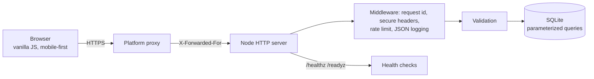

# InternHub: Production-Ready Internship Portal

A full-stack internship portal: browse and search internships, then apply through a secure,
accessible, mobile-first form. Built as a capstone to show **deployment, documentation, quality
assurance, performance, and product thinking**.

| Deliverable | Link |
|---|---|
| Live application | `https://<your-app>.onrender.com`  *(add after deploying, see [docs/DEPLOY.md](docs/DEPLOY.md))* |
| GitHub repository | `https://github.com/<you>/internhub` |
| Test evidence | [docs/TEST_REPORT.md](docs/TEST_REPORT.md) (28 API tests) · [docs/QA_EVIDENCE.md](docs/QA_EVIDENCE.md) (59 browser checks + screenshots) |
| Walkthrough video | `<paste link>`  *(script: [docs/WALKTHROUGH_SCRIPT.md](docs/WALKTHROUGH_SCRIPT.md))* |


## Quick start
```bash
npm start          # http://localhost:3000   (Node 22.13+, no npm install needed)
npm test           # 28 API, security and regression tests (no dependencies)
npm install && npx playwright install chromium
npm run qa         # 59 browser checks: user journey, mobile, accessibility, performance, security
```

## Architecture


```
server/   index.js (entry, graceful shutdown) · app.js (routes, static, logging) · db.js · validate.js · security.js · logger.js
public/   index.html · app.js · styles.css
test/     api.test.js (28 tests)
scripts/  qa.js (Playwright: journey, mobile, a11y, performance, security)
docs/     ARCHITECTURE.md · DEPLOY.md · SECURITY_CHECKLIST.md · TEST_REPORT.md · QA_EVIDENCE.md · WALKTHROUGH_SCRIPT.md
```

## API
| Method | Path | Notes |
|---|---|---|
| GET | `/api/internships?search=&page=&limit=` | Paginated (`limit` 1-50). Returns `data, page, limit, total, hasMore` |
| GET | `/api/internships/:id` | 404 if unknown |
| POST | `/api/applications` | JSON only. `201` created · `409` duplicate · `422` field errors · `429` rate limited |
| GET | `/healthz` | Liveness: process is up |
| GET | `/readyz` | Readiness: database answers a query (503 otherwise) |

## Configuration
| Variable | Default | Purpose |
|---|---|---|
| `PORT` | 3000 | Listen port |
| `DB_PATH` | `internhub.db` | SQLite file (use a persistent disk path in production) |
| `LOG_LEVEL` | `info` | `debug`, `info`, `warn`, `error`, `silent` |
| `TRUST_PROXY` | `false` | Set `true` **only** behind a proxy you control, so the rate limiter sees real client IPs |

## Operations
**Logging.** One JSON line per event, with a request id that is also returned as `X-Request-Id`.
Bodies and query strings are never logged, so no personal data reaches the logs (a test enforces this).
```json
{"time":"2026-11-25T02:13:23.895Z","level":"warn","msg":"request","id":"c55f07e2","method":"POST","path":"/api/applications","status":422,"ms":3.5}
{"time":"2026-11-25T02:13:23.899Z","level":"info","msg":"application_created","id":"da02cdcb","applicationId":1,"internshipId":1}
```
**Health checks.** `/healthz` and `/readyz` are exempt from rate limiting so monitors never get blocked.
**Graceful shutdown.** `SIGTERM` stops new connections, finishes in-flight requests, then exits.

## Quality results (summary)
- **Accessibility:** keyboard-only use, skip link, focus management, labelled fields, WCAG AA contrast in light and dark, reduced-motion support
- **Mobile:** no horizontal scroll from 320px up, 44px touch targets, full-screen form, 16px inputs (no iOS zoom)
- **Performance:** about 6 KB total page weight (gzip), FCP well under 1.5 s, CLS 0, API p95 under 25 ms, assets cached with ETag
- **Security:** CSP without inline scripts, parameterized SQL, server-side validation, rate limits, safe errors, no PII in logs

Full numbers are in [docs/QA_EVIDENCE.md](docs/QA_EVIDENCE.md).

## Known limitations (honest list)
- The rate limiter is in memory, so it resets on restart and is per instance. Use Redis for multiple instances.
- SQLite on a free host without a disk resets on redeploy. Fine for a demo; add a disk or use Postgres for real data.
- No login or admin view yet, so applications are stored but not reviewable in the UI.
- No email confirmation or CAPTCHA, so spam protection relies on rate limits and duplicate blocking.
